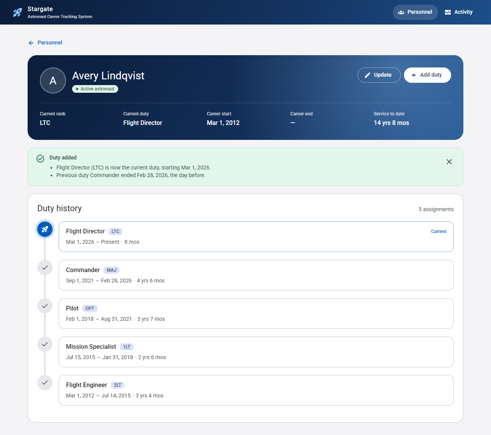

# Stargate: Astronaut Career Tracking System (ACTS)

[](https://github.com/Acostan13/technical-exercise/actions/workflows/ci.yml)

This is my solution to the Stargate technical exercise. The original instructions are in [tech_exercise/package/exercise1/README.md](tech_exercise/package/exercise1/README.md).

**What was delivered:**

- **API:** a corrected and hardened .NET 8 Web API.
  - It enforces every business rule.
  - It logs every process to the database.
  - 84 automated tests cover 100% of lines and 95% of branches.
- **UI:** an Angular 21 front end for looking up an astronaut's duty history and adding to it.



---

## Contents

1. [Quick start](#quick-start)
2. [Requirements checklist](#requirements-checklist)
3. [Defects found and fixed](#defects-found-and-fixed)
4. [Architecture and design patterns](#architecture-and-design-patterns)
5. [Assumptions and design decisions](#assumptions-and-design-decisions)
6. [Testing](#testing)
7. [Project structure](#project-structure)
8. [What I would do next](#what-i-would-do-next)

---

## Quick start

**Prerequisites:** .NET 8 SDK, and Node.js 20.19+, 22.12+ or 24+.

```bash
cd tech_exercise/package/exercise1

# 1. API: creates and migrates starbase.db automatically. Runs on http://localhost:5204 (Swagger at /swagger).
dotnet run --project api --launch-profile http

# 2. UI: in a second terminal. Runs on http://localhost:4200.
cd ui
npm install
npm run seed      # optional: demo data, created through the API so every rule applies
npm start
```

**Running the tests:**

```bash
cd tech_exercise/package/exercise1
dotnet test StargateAPI.sln                   # API: 84 tests
cd ui && npm test -- --watch=false            # UI: 35 tests
```

See [tests/README.md](tech_exercise/package/exercise1/tests/README.md) for how to produce the coverage report.

---

## Requirements checklist

### Enhance the Stargate API (required)

| Requirement | Endpoint | Status |
|---|---|---|
| Retrieve a person by name | `GET /Person/{name}` | ✅ Matching ignores case. Returns 404 if the name is unknown. |
| Retrieve all people | `GET /Person` | ✅ Includes people with no astronaut assignment. |
| Add/update a person by name | `POST /Person`, `PUT /Person/{name}` | ✅ The update endpoint was **missing** and has been added. |
| Retrieve Astronaut Duty by name | `GET /AstronautDuty/{name}` | ✅ This endpoint **ran the wrong query** and never returned duties. Fixed. |
| Add an Astronaut Duty | `POST /AstronautDuty` | ✅ Applies every rule below. |

### Tasks

| Task | How it was met |
|---|---|
| Generate the database | Migrations run on startup, so `starbase.db` is created automatically. A new migration fixes schema drift in the original and adds the constraints that enforce the rules. |
| Enforce the rules | Each rule is enforced in code, and the key ones also by the database. See [Rules](#rules) below. |
| Improve defensive coding | <ul><li>Input validation.</li><li>Domain exceptions.</li><li>One central exception handler that never leaks internal details.</li><li>Concurrency guards.</li><li>Cancellation support.</li></ul> |
| Add unit tests (identify the most impactful methods; >50% coverage) | 84 tests, 100% line and 95% branch coverage. The ranked list of most impactful methods is in [tests/README.md](tech_exercise/package/exercise1/tests/README.md#which-methods-matter-most-and-why). |
| Implement process logging (log exceptions, log successes, store in the database) | <ul><li>A `ProcessLoggingBehavior` records every process in a `ProcessLog` table.</li><li>Levels: successes → Information, rejected requests → Warning, unexpected exceptions → Error with full detail.</li><li>Viewable via `GET /ProcessLog` and in the UI.</li></ul> |

### Rules

| # | Rule | Where it is enforced |
|---|---|---|
| 1 | A Person is uniquely identified by their Name. | A pre-processor check, ignoring case and surrounding spaces, plus a **unique index** in the database. |
| 2 | A Person with no astronaut assignment has no Astronaut records. | Astronaut records are only ever created by adding a duty. Covered by a test. |
| 3 | Only one current Duty Title, Start Date and Rank at a time. | <ul><li>The Astronaut Detail record holds the single current value.</li><li>A **filtered unique index** allows only one open-ended duty per person.</li></ul> |
| 4 | The Current Duty has no Duty End Date. | Set by the duty handler, and backed by the same index as rule 3. |
| 5 | The previous duty ends the day before the new one starts. | Set by the duty handler inside one transaction. The new duty must start after the current one, which is re-checked under the write lock. |
| 6 | 'RETIRED' means the person is retired. | `DutyTitles.IsRetired`, which ignores case and surrounding spaces. |
| 7 | Career End Date is one day before the Retired Duty Start Date. | Set by the duty handler. Now also correct when RETIRED is the person's *first* duty, which was a bug. |

### User interface (encouraged)

| Requirement | How it was met |
|---|---|
| Production-quality web app (Angular preferred) | <ul><li>Angular 21 with Material, typed API client and centralised error handling.</li><li>Empty, error and not-found states.</li><li>Accessible, works on mobile.</li><li>35 unit tests.</li></ul> |
| Call(s) to retrieve an individual's astronaut duties | The astronaut page calls `GET /AstronautDuty/{name}` and shows the duty history as a timeline. |
| Display the progress of the process and the results | <ul><li>A global progress bar and loading placeholders.</li><li>When adding a duty, a **preview** of what the rules will do, then a **summary** of what changed.</li><li>An **Activity** page showing the process log, with optional live refresh.</li></ul> |

More detail is in [ui/README.md](tech_exercise/package/exercise1/ui/README.md).

---

## Defects found and fixed

### In the original code

| Severity | Defect | Fix |
|---|---|---|
| Critical | **SQL injection.** Names were pasted directly into SQL in three handlers. A name like `O'Brien` broke the query, and a crafted name could run arbitrary SQL. | All queries now use EF Core LINQ, which sends values as parameters. Dapper was removed. |
| High | `GET /AstronautDuty/{name}` sent `GetPersonByName`, so it **never returned duties**. | It now sends `GetAstronautDutiesByName`. |
| High | `CreatePersonPreProcessor` **never ran**: MediatR does not register pre-processors by default, so duplicate people were accepted. | All pre-processors are registered automatically. A test checks each one is registered exactly once. |
| High | The duplicate-duty check ignored the person, so two people could not hold the same title on the same date. | The check now looks only at the same person's duties. |
| High | When RETIRED was a person's first duty, the Career End Date was set to the retirement date instead of the day before. | Both cases now use the same rule. |
| High | Unknown names caused a `NullReferenceException`, returned as a 500. | They now return 404 with a clear message. |
| High | The *update* person requirement was not implemented. | `PUT /Person/{name}` added. |
| High | Name uniqueness was not enforced by the database. | Unique index added. |
| Medium | <ul><li>Error handling was inconsistent: one endpoint had no `try/catch`, and every failure returned 500.</li><li>Raw `ex.Message` was sent to clients.</li><li>The business layer threw HTTP exceptions.</li></ul> | <ul><li>Domain exceptions, mapped to 400/404/409 by one `IExceptionHandler`.</li><li>Unexpected errors return a generic 500.</li></ul> |
| Medium | No input validation: blank fields were accepted, a missing start date was stored as `0001-01-01`, and a duty could start before the current one. | <ul><li>FluentValidation runs in the MediatR pipeline, before the pre-processors.</li><li>A pre-processor rejects a duty that starts before the current one.</li></ul> |
| Medium | **Schema drift:** `CareerStartDate` was nullable in the database but required in the model. | Corrected in a migration. |
| Low | <ul><li>Dapper and EF Core were mixed.</li><li>The business layer depended on the `Controllers` namespace.</li><li>Pre-processors made synchronous database calls.</li><li>The database was never created.</li><li>Seed data used `DateTime.Now` and was commented out.</li></ul> | <ul><li>One data-access approach.</li><li>Corrected layering.</li><li>Async calls with cancellation tokens.</li><li>Migrations run on startup.</li></ul> |

### Found by the new tests

| Defect | How it was found | Fix |
|---|---|---|
| **Race condition when adding duties.** Two requests at the same moment could both pass the "starts after the current duty" check. The one with the earlier date could then close the later duty and become current. | A test sending concurrent HTTP requests. A deterministic test now reproduces it, and that test fails without the fix. | The handler re-checks inside its transaction, which in SQLite holds the write lock (`BEGIN IMMEDIATE`). |
| When a race was caught by a database constraint, the response was a correct 409, but the log recorded an unexpected **Error**. | The concurrency test, which checks that no Error entries are logged. | `StargateContext` converts constraint violations into a `ConflictException`. |
| Log levels were returned as numbers, and timestamps had no `Z` suffix, so the UI would have shown local time incorrectly. | HTTP-level tests. | Enums are serialised as strings, and timestamps are read back as UTC. |
| The UI's add/update dialog reloaded the whole page when submitted. | A headless-browser walkthrough of the UI. | The form now uses a `FormGroup`, so Angular handles the submit. |

---

## Architecture and design patterns

I kept the existing patterns and fixed the places where the code had drifted from them.

```
HTTP ─▶ Controller ─▶ MediatR pipeline ───────────────────────────────────────────────▶ Handler ─▶ EF Core ─▶ SQLite
                       │ 1. ProcessLoggingBehavior     records the outcome of everything below
                       │ 2. ValidationBehavior         FluentValidation: is the input well-formed?
                       │ 3. RequestPreProcessorBehavior business rules checked against existing data
        ◀── StargateExceptionHandler ── domain exceptions ─▶ 400 / 404 / 409, anything else ─▶ generic 500
```

- **CQRS with MediatR:**
  - Each operation is a request class with its own handler, and commands are kept separate from queries.
  - Each command or query file contains, in order and where needed: the request, its validator, its pre-processor, its handler and its result.
- **Pipeline behaviours** handle cross-cutting concerns: logging, validation and rule checks. Handlers contain only the domain logic.
- **Defence in depth:**
  - Validation checks the shape of the input.
  - Pre-processors check the business rules.
  - Handlers re-check anything that could change while another request runs at the same time.
  - Database constraints are the final guard.
- **One error contract.** Every response, success or failure, uses the same `{ success, message, responseCode }` envelope as the original API. Validation failures add an `errors` array.
- **DTO projections.** Queries project directly to response types, so EF entities are never serialised.

---

## Assumptions and design decisions

The README leaves a few behaviours open. Each assumption below is made explicit and covered by tests.

1. **Updating a person means renaming them.** Name is the only attribute of a Person; astronaut data changes only through duties.
2. **Names are compared ignoring case and surrounding whitespace.** "john doe " and "John Doe" are the same person.
3. **A new duty must start after the current one.** Otherwise the previous duty would end before it began. Such requests get a 400.
4. **A duty added after RETIRED clears the Career End Date.** The README does not cover this. I chose to keep Astronaut Detail consistent with the current duty rather than invent a rule that rejects the update, because the external service is the source of truth.
5. **Dates are calendar dates.** Times are discarded on input. The UI never converts dates through UTC, so they cannot shift by a day.
6. **The original response envelope is kept**, for compatibility with existing clients, rather than switching to RFC 7807 ProblemDetails.
7. **Request bodies no longer use C# `required`.** It caused missing fields to fail during deserialisation, with an error that exposed internal type names. Validation now reports them as "Name is required.".
8. **`POST /Person` takes `{"name": "..."}`** instead of a bare JSON string, to match the other endpoints. This is a small change to the request format.
9. **Angular 21 rather than 22.** Version 22 requires Node ≥ 24.15. Version 21 runs on the Node versions reviewers are most likely to have.

---

## Testing

| Suite | Tests | What it covers |
|---|---|---|
| API (xUnit) | 84 | <ul><li>Every rule.</li><li>A regression test for each fixed defect.</li><li>Validation, the exception mapping and process logging.</li><li>Every endpoint over HTTP (`WebApplicationFactory`).</li><li>Concurrency against a real SQLite file.</li><li>Swagger generation.</li></ul> |
| UI (Vitest) | 35 | <ul><li>The API client: URLs, encoding and error normalisation.</li><li>The progress tracking.</li><li>Date handling, including time-zone safety.</li><li>Status rules, the change summary, filtering, the timeline component and the app shell.</li></ul> |

- **API tests use real SQLite (in memory), not EF Core's InMemory provider.** InMemory ignores unique indexes, filtered indexes, collations and transactions, which are exactly the features several rules depend on.
- **CI** ([.github/workflows/ci.yml](.github/workflows/ci.yml)) runs on every push and pull request:
  - builds the API with warnings treated as errors
  - checks the migrations match the model
  - runs the API tests with a coverage report in the job summary
  - checks UI formatting, runs the UI tests and builds the UI

---

## Project structure

```
tech_exercise/package/exercise1/
├── StargateAPI.sln
├── api/                          .NET 8 Web API
│   ├── Controllers/              thin controllers: Person, AstronautDuty, ProcessLog
│   ├── Business/
│   │   ├── Commands/ Queries/    MediatR requests: validator, pre-processor, handler, result
│   │   ├── Data/                 EF Core entities, configuration and StargateContext
│   │   ├── Migrations/
│   │   ├── Validation/           ValidationBehavior and shared field rules
│   │   ├── Logging/              ProcessLoggingBehavior and ProcessLogWriter
│   │   ├── Exceptions/ Rules/ Dtos/ Responses/
│   └── Infrastructure/           exception handler, invalid-request response factory
├── tests/StargateAPI.Tests/      xUnit: Commands, Queries, Validation, Logging, Api, Data, Rules
└── ui/                           Angular 21 app (see ui/README.md)
```

---

## What I would do next

These are out of scope for the exercise, but a production deployment would need them:

- **Authentication and authorisation.** The API is currently open, as it was in the original. It needs authentication, and separate permissions for reading and writing.
- **A server-grade database** (SQL Server or PostgreSQL). Migrations would then run as a deployment step instead of at startup.
- **Paging** on `GET /Person`, and a **retention policy** for `ProcessLog`. Request data in the log should be redacted if it ever contains personal data.
- **Idempotent processing** of updates from the external service, for example accepting a duty that is already recorded as a no-op instead of returning 409.
- **Observability:** OpenTelemetry traces and metrics alongside the process log.
- **End-to-end browser tests** in CI. Playwright was used during development to check the UI manually.
