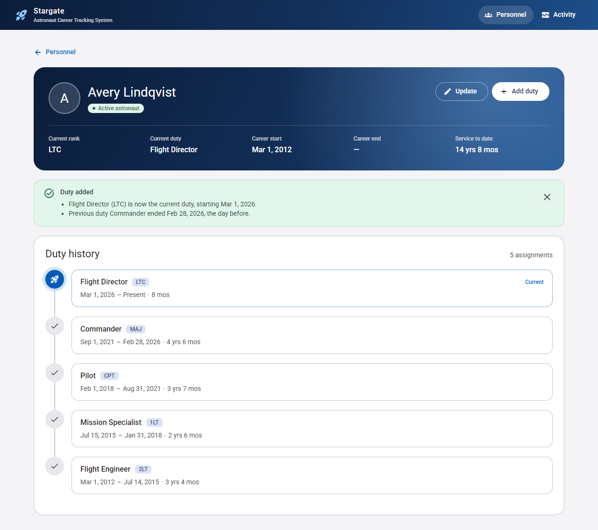

# Stargate ACTS: User Interface

This is the Angular 21 front end for the Astronaut Career Tracking System. It uses Angular Material, standalone components, signals, zoneless change detection and Vitest.



## Running it

You need the Stargate API running first. From `exercise1/`:

```bash
dotnet run --project api --launch-profile http   # API on http://localhost:5204
```

Then, from `exercise1/ui/`:

```bash
npm install
npm run seed     # optional: adds demo people and duty histories through the API
npm start        # http://localhost:4200
```

| Command | What it does |
|---|---|
| `npm start` | Starts the dev server. Calls to `/api/*` are proxied to the API (see `proxy.conf.json`), so the API needs no CORS configuration. |
| `npm test` | Runs the unit tests (Vitest). |
| `npm run build` | Makes a production build in `dist/`. |
| `npm run seed` | Adds fictional demo data. It goes through the public API, so every business rule applies. Running it again is safe. |

The default API address is `http://localhost:5204`. To point the seed at another address, set `API_URL`. For the dev server, edit `target` in `proxy.conf.json`.

## How the UI meets the README requirements

| Requirement | How it is met |
|---|---|
| Implement calls to retrieve an individual's astronaut duties | **Astronaut page** (`/people/:name`) calls `GET /AstronautDuty/{name}`. It shows the person's current astronaut details and a timeline of their duty history. |
| Display the progress of the process | <ul><li>A global progress bar runs for every API call.</li><li>Placeholder rows show while each page loads.</li><li>Buttons show a busy state while saving.</li><li>The **Activity** page shows the API's process log: each process, its outcome, and how long it took. It can refresh automatically.</li></ul> |
| Display the results | <ul><li>The add-duty dialog shows a **preview** of what the rules will do, e.g. "Commander will end on Feb 28, 2025".</li><li>After saving, a **summary** shows what actually changed.</li><li>The new entry is highlighted in the timeline.</li><li>Errors from the API appear inline, next to the field or form they relate to.</li></ul> |
| Production-level quality | <ul><li>A typed API client with consistent error handling.</li><li>Empty, error and not-found states.</li><li>Keyboard and screen-reader support.</li><li>Works on small screens and respects reduced-motion settings.</li><li>Pages load on demand.</li><li>Unit tests.</li></ul> |

## Structure

```
src/app/
  core/
    api/            typed client for every endpoint, response models, error normalisation (ApiError)
    loading/        interceptor + service behind the global progress bar
    notifications/  snack-bar wrapper
  shared/           dates (local calendar dates; see below), astronaut status, validators, status badge
  features/
    people/         personnel list (search, status filter, summary), add/update person dialog
    astronaut/      astronaut record, duty timeline, add-duty dialog, before/after change summary
    activity/       process log viewer
```

## Design notes

- **Dates are calendar dates, not points in time.**
  - The API stores duty dates without a time zone.
  - The UI parses and formats them as local dates (`shared/dates.ts`). It never converts them through UTC: `toISOString()` would shift the date by a day for users outside UTC.
  - Tests cover this.
- **The client checks what it can; the server has the final say.**
  - The add-duty date picker will not accept a date before the current duty starts.
  - Any business rule the server rejects (for example, a duplicate name) is still shown inline in the form.
- **Background polling is silent.** The Activity page's live refresh is marked as a silent request, so it does not keep flashing the global progress bar.

## Troubleshooting

**`npm test` fails with *"Vitest failed to find the runner"*.** Your shell's current path has a lowercase drive letter (`c:\...`). VS Code's integrated terminal on Windows can do this. Vitest then loads two copies of itself. Run the tests from a path that starts with an uppercase `C:\`, for example:

```powershell
cd C:\path\to\exercise1\ui
```
